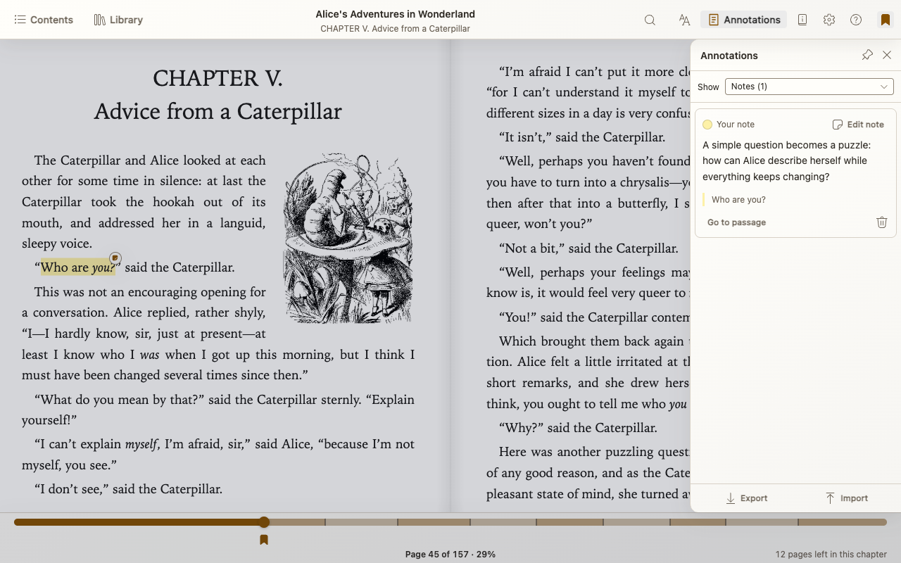

# Annotations and Bookmarks

Choose **Annotations** in the reader toolbar to see your highlights, notes,
and bookmarks. Use **Show** to filter the list.

## Save and revisit a bookmark

Click the toolbar's bookmark button or press **Mod+B** to bookmark your
current position. Use it again to remove the bookmark. **Mod** means Command
on Mac or Control elsewhere.

Choose **Annotations → Show → Bookmarks** to revisit or remove saved places.
Bookmark flags on the [progress bar](book-navigation.md#move-along-the-progress-bar)
also jump to saved places.

Bookmarks supplied with the book have a **Publisher note** tag and cannot be deleted.

## Highlight text and add a note

1. Select a passage in the book.
2. Choose a highlight color or underline, or **Add note** to highlight and
   write a note together.
3. Choose **Save** when your note is ready.

In paginated reading, new highlights and notes are limited to the visible page in
the document where you selected text. Dragging into a top or bottom margin, or
extending a keyboard selection, cannot include preceding or following pages.
Each side of a two-page spread is separate, including pages from different
chapters; selecting across pages is not a supported annotation workflow.
If CSS reordering leaves disjoint visible text separated by off-page content,
select within one contiguous visible passage rather than joining those spans.
Existing saved or imported annotations are not shortened or rewritten.

Open a highlight to edit or delete it, or find it in **Annotations**.
**Go to passage** takes you back to its location. Save note edits before
leaving the reader.

## Export or import annotations

Choose **Export** in **Annotations** to back up or share your highlights,
notes, bookmarks, and labels as an **EPUB Annotations 1.0 JSON file**.

Choose **Import** to load a compatible JSON file. Use the same book or
edition for best results; compatibility varies between tools.
Unsupported locations and detected duplicates are skipped.

[Back to the Ambra guide](README.md)
